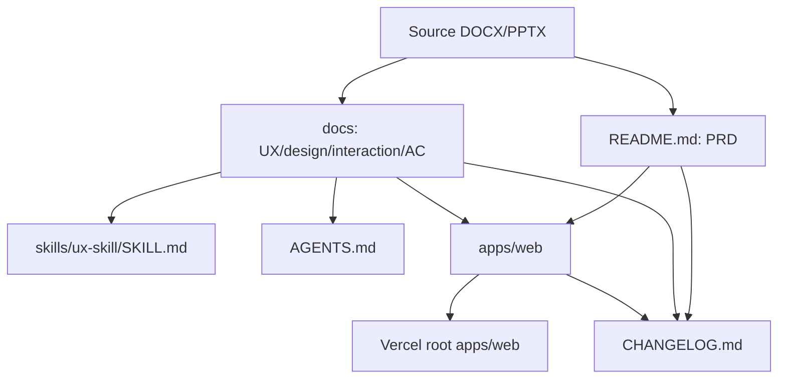

# PRD + UX Skill Repository Implementation Plan

> **For agentic workers:** Follow the tasks in order and verify each task before continuing.

**Goal:** Publish a second, separate public repository that presents the original PRD, complete UX source specifications, reusable UX skill, agent instructions, and app/deployment source as one traceable progress package.

**Architecture:** Keep product requirements and UX specifications as source documentation; the reusable skill references and operationalizes those documents; root `AGENTS.md` sets repository-wide guardrails; `apps/web` remains the implementation and Vercel root directory. Publish via a new public GitHub repository and preserve the existing PRD-only repo.

**Architecture Diagram:**

**Tech Stack:** Existing Next.js App Router, TypeScript, React, Supabase client/schema, PostgreSQL migrations, Vercel configuration; Markdown for requirements and agent guidance.

## Global Constraints
- Never modify `/Users/fiko942/Desktop/Kalender Tugas Terintegrasi` after copying its reviewed source into the second repo.
- Never modify `/Users/fiko942/Desktop/Rekayasa Interaksi` or its remote.
- Do not claim Supabase migrations or external reminders work without a live verified environment.
- Keep `.env*` secrets ignored while tracking only `.env.example`.
- Vercel Root Directory remains `apps/web`; standalone local smoke command is `node .next/standalone/server.js`.
- Every PRD acceptance ID AC-001 through AC-043 must be traceable; testing statuses must reflect evidence.
- Public repo: `fiko942/kalender-tugas-terintegrasi-ux-skill`.

---

### Task 1: Extract source deliverables and establish traceability

**Files:**
- Create: `README.md`
- Create: `docs/PRD-SOURCE.md` only if needed to preserve source wording separately from the root PRD
- Create: `docs/UX-SPEC.md`
- Create: `docs/DESIGN-SYSTEM.md`
- Create: `docs/INTERACTION-SPEC.md`
- Create: `docs/ACCEPTANCE-CRITERIA.md`
- Create: `docs/SOURCE-DECISIONS.md` to record unique context and conflicts found in the 11-slide PPTX overview
- Test: `scripts/check-docs.py`

**Interfaces:**
- Consumes: six source DOCX files and PRD Overview PPTX from `/Users/fiko942/Downloads/PRD-20261123T114636Z-1-001.zip`.
- Produces: complete Markdown documents and deterministic required-heading/AC-ID validation.

- [ ] Extract `word/document.xml` paragraphs from nested DOCX archives while preserving headings, lists, and tables into Markdown. Inspect PPTX text and record whether it contains any unique requirement.
- [ ] Write a Python completeness check that fails when any required source heading is missing, the 43 AC identifiers are not each present once in PRD source traceability, or internal links point to missing docs.
- [ ] Run `python3 scripts/check-docs.py`; expected output reports all source specs present and AC-001..AC-043 found.
- [ ] Review source content for disagreements (particularly product described as independent app vs LMS feature) and preserve exact source meaning; document unresolved conflicts rather than silently selecting.

### Task 2: Add reusable UX skill and root agent instructions

**Files:**
- Create: `skills/ux-skill/SKILL.md`
- Create: `AGENTS.md`
- Test: `scripts/check-docs.py`

**Interfaces:**
- Consumes: `docs/UX-SPEC.md`, `docs/DESIGN-SYSTEM.md`, `docs/INTERACTION-SPEC.md`, `docs/ACCEPTANCE-CRITERIA.md`, `README.md`, and app stack docs.
- Produces: skill named `kalender-tugas-ux` with valid YAML frontmatter and a complete task-oriented workflow.

- [ ] Define skill frontmatter (`name`, `description`) and triggers for UX design/implementation/review of this product.
- [ ] Include spec-first reading order; design-token/component consistency; interaction states; form/error/empty/loading feedback; keyboard and semantic accessibility; responsive desktop/tablet/mobile; reduced motion; cross-view state consistency; evidence-based AC status; explicit limits for auth/persistence/notification delivery.
- [ ] Define pre/post implementation UX checklists and browser verification criteria without replacing project AGENTS instructions.
- [ ] Set root `AGENTS.md` to preserve all 14 source sections while pointing to `docs/` paths and require testing/spec conflict escalation.
- [ ] Run structural checker and inspect frontmatter, required headings, and all referenced paths.

### Task 3: Package app and deployment documentation

**Files:**
- Create: `apps/web/**` from the existing reviewed standalone repo.
- Modify: `apps/web/README.md` for all three ordered migrations and standalone start.
- Test: app scripts and deployment metadata.

**Interfaces:**
- Consumes: existing app code and `.env.example`.
- Produces: Vercel-ready `apps/web` root and standalone production smoke target.

- [ ] Copy source files only; exclude `.next`, `node_modules`, `.env.local`, and `tsconfig.tsbuildinfo`.
- [ ] Verify migration order lists schema, processing state, and atomic reminder sync.
- [ ] Verify Vercel config has `framework: nextjs`, `buildCommand: npm run build`, and Vercel root directory documentation says `apps/web`.
- [ ] Verify `git check-ignore` excludes `.env.local` and build outputs while allowing `.env.example`.

### Task 4: Changelog, tests, and release evidence

**Files:**
- Create: `CHANGELOG.md`
- Modify: docs status if validation reveals a gap.

**Interfaces:**
- Consumes: test/build/browser outputs for this repo.
- Produces: clear completed/pending status report.

- [ ] Document UX source package and reusable skill as delivered; list app checks actually run and limitations still unverified.
- [ ] Run `npm run lint`, `npm run typecheck`, `npm test`, `npm run build` from `apps/web` and the documentation completeness script.
- [ ] Start standalone server on a free port and verify `/` HTTP 200 and title.
- [ ] Browser-test one validation and create/edit or demo interaction, navigation across tasks/calendar, and responsive mobile viewport; write any remaining limitation explicitly.
- [ ] Scan full diff, secrets, forbidden generated artifacts, contradictory claims, and README links.

### Task 5: Commit and publish distinct repository

**Files:** all reviewed repository deliverables.

**Interfaces:**
- Consumes: validated worktree and GitHub authentication.
- Produces: public remote `https://github.com/fiko942/kalender-tugas-terintegrasi-ux-skill` with `main` pointing to reviewed commit.

- [ ] Verify target repository is absent, GitHub identity is `fiko942`, and current repo has no unintended remotes.
- [ ] Stage the exact reviewed source/docs only; run `git diff --cached --check` and inspect staged file list and secrets.
- [ ] Create initial commit, create new public repo, push `main`, and verify `isPrivate=false` and remote commit SHA equals local HEAD.
- [ ] Recheck PRD-only repo `HEAD`, status, and remotes unchanged.

## Self-review
- Coverage: README/UX/design/interaction/AC docs, reusable skill, AGENTS, app, changelog, checks, and separate public repo are each assigned to a task.
- Scope: no live Supabase or Vercel setup is assumed; deployment setup is delivered, live deployment is explicitly pending.
- Ambiguity: “UX Skill” was clarified as both complete UX specs and reusable skill.
- Risks: DOCX extraction can lose table/list semantics; validation compares source paragraph/heading text and requires human review of extracted tables. PPTX may add context; inspect it before implementation.
